<picture><source media="(prefers-color-scheme: dark)" srcset="assets/dist/hero-remote-jobs-dark.svg"><source media="(prefers-color-scheme: light)" srcset="assets/dist/hero-remote-jobs-light.svg"></picture>

<a href="#open-jobs"><picture><source media="(prefers-color-scheme: dark)" srcset="assets/dist/btn-primary-dark.svg"><source media="(prefers-color-scheme: light)" srcset="assets/dist/btn-primary-light.svg"></picture></a>

<a href="https://chromewebstore.google.com/detail/gmdkffapbfeanfecgcodocfcefldjaho"><picture><source media="(prefers-color-scheme: dark)" srcset="assets/dist/btn-extension-dark.svg"><source media="(prefers-color-scheme: light)" srcset="assets/dist/btn-extension-light.svg"></picture></a>&nbsp;&nbsp;<a href="https://jobhacki.com/login-v2"><picture><source media="(prefers-color-scheme: dark)" srcset="assets/dist/btn-account-dark.svg"><source media="(prefers-color-scheme: light)" srcset="assets/dist/btn-account-light.svg"></picture></a>

Join the JobHacki Discord community to talk about jobs with other job seekers.

<a href="https://discord.gg/RApjXmgnwA">Talk with others about remote jobs in #job-leads.</a>

<table><tr><td align="center" valign="top"><h3>49,999</h3>open remote jobs in this list (latest refresh)</td><td align="center" valign="top"><h3>150</h3>freshest rows shown below</td><td align="center" valign="top"><h3>2026-11-09</h3>newest posting date</td></tr></table>

Snapshot 2026-11-09 12:20 UTC

**Hi, I'm Sophia, JobHacki's AI assistant. Pick a list, inspect a role, and follow its employer link.**

Looking to work from home or from anywhere? This list is a fresh slice of remote jobs taken from employers' own hiring systems, last updated on Nov 9, 2026.

[Back to all 12 lists](https://github.com/Jobhacki/jobs)

 

<picture><source media="(prefers-color-scheme: dark)" srcset="assets/dist/divider-dark.svg"><source media="(prefers-color-scheme: light)" srcset="assets/dist/divider-light.svg"></picture>

## Open jobs

**49,999 open remote jobs seen in the latest refresh.** The table shows the freshest 150. **Last updated: 2026-11-09 12:20 UTC.** Apply links go to the employer's career page or hiring system.

<!-- JOBS_TABLE_START -->
| Role | Employer | Location | Pay | Posted | Apply |
|---|---|---|---|---|---|
| Vice President, Global Channel Partnerships | AIRS Medical Inc | US |  | 2026-11-09 | [Apply](https://apply.workable.com/j/460C1AC6E5) |
| Mainframe Developer (Unisys OS2200) | AG Consulting Partners, Inc. | Tacoma, Washington, US |  | 2026-11-09 | [Apply](https://apply.workable.com/j/8A8CB38387) |
| Finance Systems Analyst | everbridge | United States |  | 2026-11-09 | [Apply](https://jobs.lever.co/everbridge/7ab7e176-6b77-4999-8f7e-4e79a3d7b3fd) |
| Head of Finance | ethena | Remote |  | 2026-11-09 | [Apply](https://jobs.lever.co/ethena/4dbebfbc-e71d-421e-ad07-7848d5bf2b2c) |
| Delivery Manager (contract outside of IR35) | twinstream | Remote |  | 2026-11-09 | [Apply](https://job-boards.eu.greenhouse.io/twinstream/jobs/5030641101) |
| Senior Web Designer | Lifted Solutions | Washington, DC, US |  | 2026-11-09 | [Apply](https://jobs.smartrecruiters.com/LiftedanUpworkCompany/3743990016722016) |
| Business Development Manager (Home & Garden) (f/m/x) - remote | refurbed | Remote |  | 2026-11-09 | [Apply](https://www.refurbed.de/jobs/?gh_jid=5030527101) |
| Regional Sales Director, Central & Eastern Europe | keyfactorinc | Remote |  | 2026-11-09 | [Apply](https://job-boards.greenhouse.io/keyfactorinc/jobs/6251421004) |
| SVP, General Counsel & Company Secretary | everway | Remote, USA |  | 2026-11-09 | [Apply](https://job-boards.greenhouse.io/everway/jobs/4727900006) |
| Head of Finance - R&D | skelar | Global, Remote |  | 2026-11-09 | [Apply](https://jobs.ashbyhq.com/SKELAR/a35e1592-2e39-4d20-b149-9b3d0689c962) |
| Senior Infrastructure Engineer, AI & ML, Penguin Random House (Open to Remote) | Bertelsmann-Jobs | New York, New York (NY), US |  | 2026-11-09 | [Apply](https://jobs.smartrecruiters.com/Bertelsmann-Jobs/744000160577350) |
| Marketing Manager - United States | light-inc | United States / New York |  | 2026-11-09 | [Apply](https://jobs.ashbyhq.com/light-inc/e3709c0c-5e4a-47cb-bcd2-cd0b8a26b634) |
| Head of Engineering | develop-health | San Francisco Bay Area |  | 2026-11-09 | [Apply](https://jobs.ashbyhq.com/develop-health/8f2a0815-a0df-481c-87b5-8365486fb57e) |
| Client Sales Specialist, New Construction, SMB | zillow | Remote-USA |  | 2026-11-09 | [Apply](https://zillow.wd5.myworkdayjobs.com/en-US/zillow_group_external/job/Remote-USA/Client-Sales-Specialist--New-Construction--SMB_P751836-1) |
| Value-Based Programs Lead (VBP Design) | Humana | Remote Nationwide |  | 2026-11-09 | [Apply](https://humana.wd5.myworkdayjobs.com/en-US/Humana_External_Career_Site/job/Remote-Nationwide/Value-Based-Programs-Lead--VBP-Design-_R-436601) |
| Senior Program Delivery Professional, Benefit Enablement & Execution | Humana | Remote Nationwide |  | 2026-11-09 | [Apply](https://humana.wd5.myworkdayjobs.com/en-US/Humana_External_Career_Site/job/Remote-Nationwide/Senior-Program-Delivery-Professional--Benefit-Enablement---Execution_R-435672) |
| Senior Learning Design Professional | Humana | Remote Nationwide |  | 2026-11-09 | [Apply](https://humana.wd5.myworkdayjobs.com/en-US/Humana_External_Career_Site/job/Remote-Nationwide/Senior-Learning-Design-Professional_R-434267) |
| Offensive Cybersecurity Engineers: Build RL Environments for AI Evaluation | terac | United States |  | 2026-11-09 | [Apply](https://jobs.ashbyhq.com/terac/342d43ab-ba49-4f68-bfbc-5edbdb097d56) |
| Creator Manager | Reacher | Remote |  | 2026-11-09 | [Apply](https://jobs.ashbyhq.com/reacher/e8ac5915-a59a-4a37-a0d0-3506e073210b) |
| Regional Vice President - Canvas - BizGov | instructure | United States |  | 2026-11-09 | [Apply](https://jobs.ashbyhq.com/instructure/738f7577-20e5-47ca-ae9f-75548b7663e5) |
| Business Development Manager | lonza | US - Walkersville MD - REMOTE |  | 2026-11-09 | [Apply](https://lonza.wd3.myworkdayjobs.com/en-US/lonza_careers/job/US---Walkersville-MD---REMOTE/Business-Development-Manager_R80731-1) |
| Consultant, Product Safety and Stewardship | Ramboll | Irvine, California, US |  | 2026-11-09 | [Apply](https://jobs.smartrecruiters.com/Ramboll3/744000160498829) |
| Sales, Channel - Regional Partners (Southeast) | meter | United States |  | 2026-11-09 | [Apply](https://jobs.ashbyhq.com/meter/ed59a4d8-6571-4a48-9e79-0d1acf680ff6) |
| Sales, Channel - Regional Partners (South Central) | meter | United States |  | 2026-11-09 | [Apply](https://jobs.ashbyhq.com/meter/3ded4642-4db9-4424-892e-0ed661da7dcf) |
| Sales, Channel - Regional Partners (Southwest) | meter | United States |  | 2026-11-09 | [Apply](https://jobs.ashbyhq.com/meter/53f9fe36-9d3f-4cc4-8611-0c1eac14d3ed) |
| Applied AI Researcher | clera | New York |  | 2026-11-09 | [Apply](https://jobs.ashbyhq.com/Clera/237b6911-30da-4a4f-a678-ae48f10220a8) |
| Inpatient Rehabilitation Facility (IRF) Quality Analyst - Healthcare | EXL | United States |  | 2026-11-08 | [Apply](https://fa-ewjt-saasfaprod1.fa.ocs.oraclecloud.com/hcmUI/CandidateExperience/en/sites/CX_2/job/22481) |
| Market Development Director - West Region | regenxbio | West Coast - Field |  | 2026-11-08 | [Apply](https://jobs.lever.co/regenxbio/ab876b2b-509e-4614-bd30-1e70506cab02) |
| Market Development Director - Northeast Region | regenxbio | Northeast US - Field |  | 2026-11-08 | [Apply](https://jobs.lever.co/regenxbio/ddfe436a-d2b1-48f6-bcd5-8b660335e73d) |
| Market Development Director - Central Region | regenxbio | Central US - Field |  | 2026-11-08 | [Apply](https://jobs.lever.co/regenxbio/4c266595-e11f-4aaa-a9e2-c949c4a06247) |
| Webflow Guru/Website Manager | veracode | Burlington, MA OR US Remote |  | 2026-11-08 | [Apply](https://www.veracode.com/career/job?gh_jid=8934577002) |
| Clinical Workflow Analyst — Federal Health IT | rackner | Remote — United States |  | 2026-11-08 | [Apply](https://job-boards.greenhouse.io/rackner/jobs/4752580005) |
| Senior Program Manager, Brand & Marketing | daylightsecurity | United States - Remote |  | 2026-11-08 | [Apply](https://job-boards.greenhouse.io/daylightsecurity/jobs/4485717009) |
| Clinical Informatics Specialist — Federal Health IT | rackner | Remote — United States |  | 2026-11-08 | [Apply](https://job-boards.greenhouse.io/rackner/jobs/4752576005) |
| Military Exercise Planner (JOMIS) | rackner | Remote — United States |  | 2026-11-08 | [Apply](https://job-boards.greenhouse.io/rackner/jobs/4752567005) |
| Enterprise SDR Manager | withpulley | New York |  | 2026-11-08 | [Apply](https://jobs.ashbyhq.com/withpulley/44d5b9f6-7142-47c4-869d-c2dfa9392ad8) |
| Federal Business Development Representative | GovSignals | Washington, DC |  | 2026-11-08 | [Apply](https://jobs.ashbyhq.com/GovSignals/304a9abc-4fe8-477a-a1ed-6808bd6ad014) |
| Creative Director | stord | Remote, United States |  | 2026-11-08 | [Apply](https://stord.wd503.myworkdayjobs.com/en-US/stord_external_career/job/Remote-United-States/Creative-Director_JR103517) |
| Account Executive, Majors - NYC | zscaler | Remote - Massachusetts, USA; Remote - New York, USA |  | 2026-11-08 | [Apply](https://job-boards.greenhouse.io/zscaler/jobs/5288612007) |
| Security Engineer (Corporate IT) | resolution | Berkeley, California |  | 2026-11-08 | [Apply](https://jobs.ashbyhq.com/resolution/3f73adc2-04ec-4d7e-be40-e43193adff6c) |
| Security Engineer (Research Infrastructure) | resolution | Berkeley, California |  | 2026-11-08 | [Apply](https://jobs.ashbyhq.com/resolution/d803b4b1-4b4a-4ea8-8ded-ae54e1e1107b) |
| Founding Member of Technical Staff | neuroscale | United States |  | 2026-11-08 | [Apply](https://jobs.ashbyhq.com/neuroscale/d8955e36-0b07-455c-a618-76d83781da5c) |
| Account Manager | frontcareers | San Francisco, CA |  | 2026-11-08 | [Apply](https://jobs.ashbyhq.com/frontcareers/625c97e4-2f4f-4109-82c2-4c5fa6ac837b) |
| Member of Technical Staff, Agents | clera | Palo Alto |  | 2026-11-08 | [Apply](https://jobs.ashbyhq.com/Clera/de96dd97-2aeb-485c-8d05-d36c5af75ad4) |
| Forward Deployed Engineer | clera | New York |  | 2026-11-08 | [Apply](https://jobs.ashbyhq.com/Clera/ff86c115-30f4-46d1-b3ff-06f3154acabe) |
| Senior Supplier Industrialization Engineer, Composite Structures | Anduril Industries | Remote |  | 2026-11-08 | [Apply](https://boards.greenhouse.io/andurilindustries/jobs/5079841007?gh_jid=5079841007) |
| MSL / Senior MSL I, Gynecologic Oncology (South Texas) | AbbVie | Houston, TX, US |  | 2026-11-08 | [Apply](https://jobs.smartrecruiters.com/AbbVie/3743990016720076) |
| MSL / Senior MSL I, Gynecologic Oncology (South Texas) | AbbVie | San Antonio, TX, US |  | 2026-11-08 | [Apply](https://jobs.smartrecruiters.com/AbbVie/3743990016720116) |
| Project Manager | Turner & Townsend | Milwaukee, Wisconsin, US |  | 2026-11-08 | [Apply](https://jobs.smartrecruiters.com/TurnerTownsend/744000160487719) |
| Solutions Lead, International Upmarket | Toast | Remote, USA |  | 2026-11-08 | [Apply](https://careers.toasttab.com/jobs?gh_jid=8363046) |
| White Space Manager, Network & Data Halls | openai | San Francisco |  | 2026-11-08 | [Apply](https://jobs.ashbyhq.com/openai/0ed12b35-0115-4ad3-81f5-ea1bb05c9f6b) |
| Civil & Structural Architect, Power Generation | openai | US - Remote |  | 2026-11-08 | [Apply](https://jobs.ashbyhq.com/openai/1a475859-21e3-45fc-9e93-8763aa1d0992) |
| Senior Product Marketing Manager, Legal AI | ironcladhq | San Francisco |  | 2026-11-08 | [Apply](https://jobs.ashbyhq.com/ironcladhq/553e9083-2d24-4dba-8ee1-75f47095b926) |
| Care Coordinator II | centene | Remote-MO |  | 2026-11-08 | [Apply](https://centene.wd5.myworkdayjobs.com/en-US/centene_external/job/Remote-MO/Care-Coordinator-II_1662023) |
| Associate Legal Engineer | harvey | Dallas |  | 2026-11-08 | [Apply](https://jobs.ashbyhq.com/harvey/28b62bdc-3d36-47eb-980d-4f52455cc3f2) |
| Associate Legal Engineer | harvey | Boston |  | 2026-11-08 | [Apply](https://jobs.ashbyhq.com/harvey/eb6318f2-957c-4d2b-8c44-054a0ef049a3) |
| Associate Legal Engineer | harvey | Chicago |  | 2026-11-08 | [Apply](https://jobs.ashbyhq.com/harvey/e2613ef0-b37c-42ab-aae2-3b47162a9401) |
| Support Engineer, PAYGO | Exa | Remote |  | 2026-11-08 | [Apply](https://jobs.ashbyhq.com/exa/f4dd7ae8-cf72-4634-b708-742601b9061c) |
| Enterprise Account Executive, West | assembledhq | United States |  | 2026-11-08 | [Apply](https://jobs.ashbyhq.com/assembledhq/539df75d-076c-4017-8d4e-55b868a31069) |
| Senior Software Support Engineer - Slinky | NVIDIA | US, UT, Remote |  | 2026-11-08 | [Apply](https://nvidia.wd5.myworkdayjobs.com/en-US/NVIDIAExternalCareerSite/job/US-UT-Remote/Senior-Software-Support-Engineer---Slinky_JR2029107) |
| HME Reimbursement Specialist Part Time | bannerhealth | Remote Arizona |  | 2026-11-08 | [Apply](https://bannerhealth.wd108.myworkdayjobs.com/en-US/careers/job/Remote-Arizona/HME-Reimbursement-Specialist-Part-Time_R4459279) |
| Supervisor, Contact Center Operations | centene | Remote-MO |  | 2026-11-08 | [Apply](https://centene.wd5.myworkdayjobs.com/en-US/centene_external/job/Remote-MO/Supervisor--Contact-Center-Operations_1674673) |
| Customer Care Specialist | bbinsurance | Remote - Illinois |  | 2026-11-08 | [Apply](https://bbinsurance.wd1.myworkdayjobs.com/en-US/careers/job/Remote---Illinois/Customer-Care-Specialist_R26_0000002986-2) |
| Senior Account Executive | bbinsurance | Remote - Florida |  | 2026-11-08 | [Apply](https://bbinsurance.wd1.myworkdayjobs.com/en-US/careers/job/Remote---Florida/Senior-Account-Executive_R26_0000003172) |
| Outside Sales Representative – Life and Disability | bbinsurance | Remote - New York |  | 2026-11-08 | [Apply](https://bbinsurance.wd1.myworkdayjobs.com/en-US/careers/job/Remote---New-York/Outside-Sales-Representative---Life-and-Disability_R26_0000003336-1) |
| Sales Operations Manager, Supplemental Insurance Solutions | Medical Access & Service Advantage | Sunrise, FL |  | 2026-11-07 | [Apply](https://recruiting.paylocity.com/Recruiting/Jobs/Details/4650152) |
| Member of Recruiting Staff - Recruiter | Liquid AI | San Francisco |  | 2026-11-07 | [Apply](https://jobs.ashbyhq.com/liquid-ai/288e7be0-5547-4fe5-b8db-fca0a9ae663f) |
| Manager, Revenue & Billing Operations | openloophealth | United States - Remote |  | 2026-11-07 | [Apply](https://jobs.ashbyhq.com/openloophealth/878f0c17-08b8-4e78-afc7-f1981b34889f) |
| Senior Account Executive | jamasoftware | Remote - US |  | 2026-11-07 | [Apply](https://www.jamasoftware.com/company/careers/posting/8350321?gh_jid=8350321) |
| Senior Product Manager: Extensible Compute | Snowflake | US-CA-Menlo Park | $200k-287.5k/yr | 2026-11-07 | [Apply](https://jobs.ashbyhq.com/snowflake/ba140960-361c-4357-8a8e-e4825f0d200b) |
| Staff Accountant, Accounts Payable | Hims & Hers | US - Remote | $75k-85k/yr | 2026-11-07 | [Apply](https://jobs.ashbyhq.com/hims-and-hers/7c1f5af8-03bb-437c-855c-3b7df76ac558) |
| Marketing Designer | Anchour | New Gloucester, ME |  | 2026-11-07 | [Apply](https://anchour.breezy.hr/p/e0dc71c53359-marketing-designer) |
| Associate Director, Media & Analytics | Anchour | New Gloucester, ME |  | 2026-11-07 | [Apply](https://anchour.breezy.hr/p/40cafd9aa0fa-associate-director-media-analytics) |
| Strategic Partnerships, Silicon Ecosystem | Liquid AI | San Francisco |  | 2026-11-07 | [Apply](https://jobs.ashbyhq.com/liquid-ai/04fe3e31-d08e-43f5-bc51-dc7e0a3fede2) |
| Solution Executive, Managed Services | neweratech | Remote |  | 2026-11-07 | [Apply](https://job-boards.greenhouse.io/neweratech/jobs/8934021002) |
| Data Engineer | higgsfieldai | San Francisco Bay Area, USA | $200k-260k/yr | 2026-11-07 | [Apply](https://jobs.ashbyhq.com/higgsfieldai/2fce2fe7-b554-4330-8fed-c59fa85f3415) |
| Payroll, Time Tracking, & Absence Consultant, Higher Education & Nonprofit | Workday | USA Remote |  | 2026-11-07 | [Apply](https://workday.wd5.myworkdayjobs.com/en-US/Workday/job/USA-Remote/Payroll--Time-Tracking----Absence-Consultant--Higher-Education---Nonprofit_JR-0111499) |
| Senior Growth / Demand Generation Manager | nectar-social | Palo Alto, CA | $165k-215k/yr | 2026-11-07 | [Apply](https://jobs.ashbyhq.com/nectar/040eb4a2-8197-408a-af29-0e4a957b55e9) |
| Scientist, Product Transfer | spearbio | Woburn, MA Headquarters | $95k/yr | 2026-11-07 | [Apply](https://jobs.ashbyhq.com/spearbio/917b80c6-d62b-4c54-9ce8-013d079d210e) |
| Senior Software Engineer, Backend (Agentic AI) | siftstack | San Francisco, CA | $180k-230k/yr | 2026-11-07 | [Apply](https://jobs.ashbyhq.com/siftstack/38350564-6a34-4c87-9f21-44e75b55da85) |
| Senior Software Engineer, Backend (Agentic AI) | siftstack | Marina Del Rey, CA | $180k-230k/yr | 2026-11-07 | [Apply](https://jobs.ashbyhq.com/siftstack/6ee2f114-3b3b-42d3-ab93-12932b330ebd) |
| Staff Backend Engineer | siftstack | Marina Del Rey, CA | $200k-260k/yr | 2026-11-07 | [Apply](https://jobs.ashbyhq.com/siftstack/34433001-1245-44ca-9a1b-3afd530cffaa) |
| Manager, Account Executive, Strategic | ramp | Remote (US) | $520k-620k/yr | 2026-11-07 | [Apply](https://jobs.ashbyhq.com/ramp/f9d015d7-d5cb-450b-9936-afd8d1c4f4cc) |
| Research Intern, Summer 2027 | category-labs | New York |  | 2026-11-07 | [Apply](https://jobs.ashbyhq.com/category-labs/248a6400-c18e-4627-9c8c-1b1054869075) |
| Forward Deployed Solution Engineer – Applied AI FDE | ServiceNow | Atlanta, Georgia, US |  | 2026-11-07 | [Apply](https://jobs.smartrecruiters.com/ServiceNow/744000160326680) |
| Director of Account Management | rillet | New York City | $290k-320k/yr | 2026-11-07 | [Apply](https://jobs.ashbyhq.com/rillet/34f78d78-2d29-4584-a961-3d4c4dede0c8) |
| Director of Revenue Operations | rillet | New York City | $220k-250k/yr | 2026-11-07 | [Apply](https://jobs.ashbyhq.com/rillet/38145e67-5e04-462b-9436-e10b0a1f72d0) |
| Clinical Subject Matter Expert | pivotal-health | Remote - US | $125k-147k/yr | 2026-11-07 | [Apply](https://jobs.ashbyhq.com/pivotal-health/734bbc07-f5be-4c26-9613-e8b97ac21e2f) |
| UX Researcher | phantom | Remote-US |  | 2026-11-07 | [Apply](https://jobs.ashbyhq.com/phantom/0c422449-5b05-41ee-a000-0d5c04f78bea) |
| Virtual Therapist | baba | Remote |  | 2026-11-07 | [Apply](https://jobs.ashbyhq.com/baba/6abb41fb-241f-4baa-a85d-b04bd248faed) |
| Revenue Operations Manager | adaptive-innovations | Remote |  | 2026-11-07 | [Apply](https://jobs.ashbyhq.com/adaptive-innovations/12affc43-f92e-47bf-a7d1-975190143790) |
| Revenue Cycle Manager | adaptive-innovations | Remote |  | 2026-11-07 | [Apply](https://jobs.ashbyhq.com/adaptive-innovations/faf58518-cee8-4987-b8fa-3bb9967bcdba) |
| Workday Test Manager | thegroove | Remote |  | 2026-11-07 | [Apply](https://thegroove.wd12.myworkdayjobs.com/en-US/thegroovecareers/job/Remote/Workday-Test-Manager_JR100201) |
| Software Engineer, Back-End - Go (NY) | Superhuman | Hub - New York | $154k-258k/yr | 2026-11-07 | [Apply](https://jobs.ashbyhq.com/Superhuman%20Platform%20Inc/9f17378e-635a-4d92-9941-e38363afab4f) |
| Software Engineer, Front-End (New York) | Superhuman | Hub - New York | $163.5k-235k/yr | 2026-11-07 | [Apply](https://jobs.ashbyhq.com/Superhuman%20Platform%20Inc/e3f4fa1f-8647-4452-90fe-495ff63f6a51) |
| Creative Operations Manager | runway-ml | Remote | $180k-240k/yr | 2026-11-07 | [Apply](https://jobs.ashbyhq.com/runway-ml/2975a88e-1519-4094-93a2-b6e66ed1a98c) |
| People Business Partner, Senior Manager (Construction) | rowan | Denver, CO Office | $125k-150k/yr | 2026-11-07 | [Apply](https://jobs.ashbyhq.com/rowan/d4c36e28-2c22-4d15-94c8-d6a7e416f5b5) |
| Lead Product Manager, Agentic Commerce | imprint | San Francisco | $190k-210k/yr | 2026-11-07 | [Apply](https://jobs.ashbyhq.com/imprint/629ef9c3-d53b-41dd-9818-0e56c8f9a58d) |
| Recruiting Coordinator - Contract | Hinge Health | San Francisco-HQ | $23.5-27/hr | 2026-11-07 | [Apply](https://jobs.ashbyhq.com/hinge-health/5a3d69d7-ed52-48e2-8d0d-1b88cf1f369e) |
| Third-Party Risk Management Analyst | Fireworks AI | San Mateo | $150k-170k/yr | 2026-11-07 | [Apply](https://jobs.ashbyhq.com/fireworks/1f11f94a-5e5b-4691-a931-1e54222afb08) |
| Account Executive | edsights | United States | $200k-250k/yr | 2026-11-07 | [Apply](https://jobs.ashbyhq.com/edsights/dfdf0065-7ec9-4c1c-a534-c4e54c897f58) |
| Senior Marketing Specialist | zillow | Remote-USA |  | 2026-11-07 | [Apply](https://zillow.wd5.myworkdayjobs.com/en-US/zillow_group_external/job/Remote-USA/Senior-Marketing-Specialist_P751602) |
| Photo Editor | zillow | Remote-USA |  | 2026-11-07 | [Apply](https://zillow.wd5.myworkdayjobs.com/en-US/zillow_group_external/job/Remote-USA/Photo-Editor_P751603-1) |
| Claims Property Adjuster | ace | Coppell, TX, Remote |  | 2026-11-07 | [Apply](https://ace.wd5.myworkdayjobs.com/en-US/careers/job/Coppell-TX-Remote/Claims-Property-Adjuster_JR202640078) |
| Field Medical Onboarding & Capability Development, US FME | amgen | United States - Remote |  | 2026-11-07 | [Apply](https://amgen.wd1.myworkdayjobs.com/en-US/careers/job/United-States---Remote/Field-Medical-Onboarding---Capability-Development--US-FME_R-260775) |
| Appeals Nurse Consultant (Remote) | CVS Health | CT - Work from home |  | 2026-11-07 | [Apply](https://cvshealth.wd1.myworkdayjobs.com/en-US/CVS_Health_Careers/job/CT---Work-from-home/Appeals-Nurse-Consultant--Remote-_R1071657) |
| Appeals Nurse Consultant (Remote) | CVS Health | CT - Work from home |  | 2026-11-07 | [Apply](https://cvshealth.wd1.myworkdayjobs.com/en-US/CVS_Health_Careers/job/CT---Work-from-home/Appeals-Nurse-Consultant--Remote-_R1053252) |
| CRM Account Executive - Commercial | ServiceNow | Boston, Massachusetts, US |  | 2026-11-07 | [Apply](https://jobs.smartrecruiters.com/ServiceNow/744000160312709) |
| People Operations Manager | Liquid AI | San Francisco |  | 2026-11-07 | [Apply](https://jobs.ashbyhq.com/liquid-ai/0b41c5d4-d6bf-4b97-8d8d-1495856d0da8) |
| Pharmacy Quality Coordinator | centene | Remote-MS |  | 2026-11-07 | [Apply](https://centene.wd5.myworkdayjobs.com/en-US/centene_external/job/Remote-MS/Pharmacy-Quality-Coordinator_1674532) |
| Retirement Plan Counselor | empower | CA Los Angeles - Remote |  | 2026-11-07 | [Apply](https://empower.wd12.myworkdayjobs.com/en-US/empower/job/CA-Los-Angeles---Remote/Retirement-Plan-Counselor_R0063415) |
| Head of Integrated Marketing | empower | Nationwide Remote |  | 2026-11-07 | [Apply](https://empower.wd12.myworkdayjobs.com/en-US/empower/job/Nationwide-Remote/Head-of-Integrated-Marketing_R0063470) |
| Senior Partner Operations Manager, Bars | clio | Remote - USA |  | 2026-11-07 | [Apply](https://clio.wd3.myworkdayjobs.com/en-US/cliocareersite/job/Remote---USA/Senior-Bar-Partner-Operations-Manager_REQ-5650) |
| Global Program Operations Manager | exos | Remote, United States |  | 2026-11-07 | [Apply](https://exos.wd501.myworkdayjobs.com/en-US/exoscareers/job/Remote-United-States/Global-Program-Operations-Manager_26-2086) |
| Director of Product, External Experiences | younglife | Remote, CO |  | 2026-11-07 | [Apply](https://younglife.wd5.myworkdayjobs.com/en-US/younglife_careers/job/Remote-CO/Director-of-Product--External-Experiences_JR106461) |
| Senior Linux Systems Engineer - EDA Infrastructure | NVIDIA | US, CA, Remote |  | 2026-11-07 | [Apply](https://nvidia.wd5.myworkdayjobs.com/en-US/NVIDIAExternalCareerSite/job/US-CA-Remote/Senior-Linux-Systems-Engineer---EDA-Infrastructure_JR2025019) |
| Sr Principal Relationship Management and Business Development Manager (Remote-E... | Capital One | 2 Locations |  | 2026-11-07 | [Apply](https://capitalone.wd12.myworkdayjobs.com/en-US/Capital_One/job/Riverwoods-IL/Sr-Principal-Relationship-Management-and-Business-Development-Manager--Remote-Eligible-_R1005388-1) |
| Principal Relationship Management and Business Development Manager (Remote-Elig... | Capital One | 2 Locations |  | 2026-11-07 | [Apply](https://capitalone.wd12.myworkdayjobs.com/en-US/Capital_One/job/Riverwoods-IL/Principal-Relationship-Management-and-Business-Development-Manager--Remote-Eligible-_R1005387-1) |
| RADIAC Test Engineer (TOC) | starfish | Remote - California |  | 2026-11-07 | [Apply](https://starfish.wd501.myworkdayjobs.com/en-US/careers/job/Remote---California/RADIAC-Test-Engineer--TOC-_R2152) |
| Regional Account Manager, Toxicology - Southwestern US | abbott | United States of America : Remote |  | 2026-11-07 | [Apply](https://abbott.wd5.myworkdayjobs.com/en-US/abbottcareers/job/United-States-of-America--Remote/Regional-Account-Manager--Toxicology---Southwestern-US_31166791-1) |
| Regional Account Manager, Toxicology - Northwestern & Midwestern US | abbott | United States of America : Remote |  | 2026-11-07 | [Apply](https://abbott.wd5.myworkdayjobs.com/en-US/abbottcareers/job/United-States-of-America--Remote/Regional-Account-Manager--Toxicology---Northwestern---Midwestern-US_31166790-1) |
| IBM BAW Software Engineer | bcbst | USA, TN, Chattanooga, Remote |  | 2026-11-07 | [Apply](https://bcbst.wd1.myworkdayjobs.com/en-US/external/job/USA-TN-Chattanooga-Remote/IBM-BAW-Software-Engineer_R-51477) |
| Sr. BAW Software Engineer | bcbst | USA, TN, Chattanooga, Remote |  | 2026-11-07 | [Apply](https://bcbst.wd1.myworkdayjobs.com/en-US/external/job/USA-TN-Chattanooga-Remote/Sr-BAW-Software-Engineer_R-51532) |
| CHOICES Care Coordinator- Maury County | bcbst | USA, TN, Nashville, Remote |  | 2026-11-07 | [Apply](https://bcbst.wd1.myworkdayjobs.com/en-US/external/job/USA-TN-Nashville-Remote/CHOICES-Care-Coordinator--Maury-County_R-52022) |
| Business Development Associate (Boston) | agcbio | Remote US - MA |  | 2026-11-07 | [Apply](https://agcbio.wd5.myworkdayjobs.com/en-US/agcbio_careers/job/Remote-US---MA/Business-Development-Associate--Boston-_JR103107) |
| Senior Buyer - Gas Power Generation | blattner | Remote/Traveling (For Corporate Use Only) |  | 2026-11-07 | [Apply](https://blattner.wd5.myworkdayjobs.com/en-US/blattnercompany/job/RemoteTraveling-For-Corporate-Use-Only/Buyer---Gas-Power-Generation_R8781) |
| Sr. Engineer - Automation | blattner | Remote/Traveling (For Corporate Use Only) |  | 2026-11-07 | [Apply](https://blattner.wd5.myworkdayjobs.com/en-US/blattnercompany/job/RemoteTraveling-For-Corporate-Use-Only/Sr-Engineer---Automation_R8990) |
| Sales Account Executive | automationanywhere | US CA Remote |  | 2026-11-07 | [Apply](https://automationanywhere.wd5.myworkdayjobs.com/en-US/automationanywherejobs/job/US-CA-Remote/Sales-Account-Executive_JR1417-1) |
| Member Guide - Wall, New Jersey | amynta | NJ - Remote |  | 2026-11-07 | [Apply](https://amynta.wd5.myworkdayjobs.com/en-US/global/job/NJ---Remote/Member-Guide---Wall--New-Jersey_2610-0593) |
| Quality & Reliability Manager | aligneddc | Remote - Oklahoma |  | 2026-11-07 | [Apply](https://aligneddc.wd12.myworkdayjobs.com/en-US/aligneddc/job/Remote---Oklahoma/Quality---Reliability-Manager_JR101393) |
| Commissioning & Reliability Manager | aligneddc | Remote - Oklahoma |  | 2026-11-07 | [Apply](https://aligneddc.wd12.myworkdayjobs.com/en-US/aligneddc/job/Remote---Oklahoma/Commissioning---Reliability-Manager_JR101394) |
| Tax Director, Corporate | armaninollp | Remote, Wisonsin |  | 2026-11-07 | [Apply](https://armaninollp.wd1.myworkdayjobs.com/en-US/armanino/job/Remote-Wisonsin/Tax-Director--Corporate_JR104528) |
| Director, Global Commercial Strategy & Operations | beigene | Remote (US) |  | 2026-11-07 | [Apply](https://beigene.wd5.myworkdayjobs.com/en-US/beigene/job/Remote-US/Director--Global-Commercial-Strategy---Operations_R37581) |
| Financial Analyst - Financial Operations | mcw | Remote-Wisconsin |  | 2026-11-07 | [Apply](https://mcw.wd503.myworkdayjobs.com/en-US/externalcareers/job/Remote-Wisconsin/Financial-Analyst---Financial-Operations_JR104216) |
| Senior Strategic Operations Consultant | allstate | US - Remote |  | 2026-11-07 | [Apply](https://allstate.wd5.myworkdayjobs.com/en-US/allstate_careers/job/US---Remote/Senior-Strategic-Planning-and-Operations-Consultant_R32906) |
| Territory Sales Manager (Salt Lake City/Provo, UT) | allstate | USA - UT (Remote) |  | 2026-11-07 | [Apply](https://allstate.wd5.myworkdayjobs.com/en-US/allstate_careers/job/USA---UT-Remote/Territory-Sales-Manager--Salt-Lake-City-Provo--UT-_R36801) |
| Territory Sales Manager (Phoenix) | allstate | USA - AZ (Remote) |  | 2026-11-07 | [Apply](https://allstate.wd5.myworkdayjobs.com/en-US/allstate_careers/job/USA---AZ-Remote/Territory-Sales-Manager--Phoenix-_R36802) |
| Spec, Clinical Integration | baxter | United States of America - Remote |  | 2026-11-07 | [Apply](https://baxter.wd1.myworkdayjobs.com/en-US/baxter/job/United-States-of-America---Remote/Spec--Clinical-Integration_JR-211345-1) |
| Data Enablement and Reporting Advisor - Evernorth - Remote | cigna | United States Work at Home |  | 2026-11-07 | [Apply](https://cigna.wd5.myworkdayjobs.com/en-US/cignacareers/job/United-States-Work-at-Home/Data-Enablement-and-Reporting-Advisor---Evernorth---Remote_26011249) |
| Strategic Consulting & Growth Manager, Digital Health Solutions | abbott | United States of America : Remote |  | 2026-11-07 | [Apply](https://abbott.wd5.myworkdayjobs.com/en-US/abbottcareers2/job/United-States-of-America--Remote/Strategic-Consulting---Growth-Manager--Digital-Health-Solutions_31166697) |
| Outbound Sales Agent, Remote | wynd | 2 Locations |  | 2026-11-07 | [Apply](https://wynd.wd5.myworkdayjobs.com/en-US/external/job/Florida-USA-work-from-home/Outbound-Sales-Agent--Remote_R-130343) |
| Outbound Sales Representative Remote | wynd | Florida, USA (work from home) |  | 2026-11-07 | [Apply](https://wynd.wd5.myworkdayjobs.com/en-US/external/job/Florida-USA-work-from-home/Outbound-Sales-Representative-Remote_R-131443) |
| Commercial HVAC Mechanical Project Manager (Remote) | carrier | CAOHO: Carrier-Home Ohio Remote Location, Remote City, OH, 43001 USA |  | 2026-11-07 | [Apply](https://carrier.wd5.myworkdayjobs.com/en-US/jobs/job/CAOHO-Carrier-Home-Ohio-Remote-Location-Remote-City-OH-43001-USA/Commercial-HVAC-Mechanical-Project-Manager--Remote-_30221111) |
| Principal Engineer, Software Quality & Engineering Governance | carrier | CAFLO: Carrier-Home Florida Remote Location, Remote City, FL, 33412 U... |  | 2026-11-07 | [Apply](https://carrier.wd5.myworkdayjobs.com/en-US/jobs/job/CAFLO-Carrier-Home-Florida-Remote-Location-Remote-City-FL-33412-USA/Principal-Engineer--Software-Quality---Engineering-Governance_30219643) |
| Senior Product Management Specialist - Commercial Modifications (Virtual) | boeing | United States - Remote |  | 2026-11-07 | [Apply](https://boeing.wd1.myworkdayjobs.com/en-US/external_careers/job/United-States---Remote/Senior-Product-Management-Specialist---Commercial-Modifications--Virtual-_JR2026528842-1) |
| Regulatory Affairs Manager - CMC | amgen | United States - Remote |  | 2026-11-07 | [Apply](https://amgen.wd1.myworkdayjobs.com/en-US/careers/job/United-States---Remote/Regulatory-Affairs-Manager---CMC_R-260820) |
| Senior Salesforce Technical Lead | amgen | United States - Remote |  | 2026-11-07 | [Apply](https://amgen.wd1.myworkdayjobs.com/en-US/careers/job/United-States---Remote/Senior-Salesforce-Technical-Lead_R-240855-1) |
| BCS Business Card Consultant - Washington | U.S. Bank | Remote, WA |  | 2026-11-07 | [Apply](https://usbank.wd1.myworkdayjobs.com/en-US/US_Bank_Careers/job/Remote-WA/BCS-Business-Card-Consultant---Washington_2026-0027637) |
| CARE Customer Experience Program Manager- Remote | Nordstrom | Seattle, WA |  | 2026-11-07 | [Apply](https://nordstrom.wd501.myworkdayjobs.com/en-US/nordstrom_careers/job/Seattle-WA/CARE-Customer-Experience-Program-Manager--Remote_R-894711-1) |
| Cytogenetics Analyst - US Remote | Labcorp | 2 Locations |  | 2026-11-07 | [Apply](https://labcorp.wd1.myworkdayjobs.com/en-US/External/job/USA---NC---Research-Triangle---1904-Alexander-Drive/Cytogenetics-Analyst---US-Remote_2638632) |
<!-- JOBS_TABLE_END -->

<b>How this list is built</b>

- Source: the JobHacki job directory. This repo only includes jobs from public company hiring systems (ATS). It leaves out hidden job boards, such as static "general apply" pages on company websites, Notion boards and others.
- Scope: United States listings plus remote roles with no country set (the same default as jobhacki.com).
- Order: newest posting date first, at most 3 rows per employer so one company cannot fill the list. Posting dates are day-level, as published by the employer system.
- Pay is shown only when the employer system publishes it.
- Employer names are plain text. Apply links open the employer's own posting; links that carry tracking or session parameters are left out.

## More lists

[All job lists (master)](https://github.com/Jobhacki/jobs)

<table><tr><td align="center" width="33%"><a href="https://github.com/Jobhacki/entry-level-jobs"><picture><source media="(prefers-color-scheme: dark)" srcset="assets/dist/card-entry-level-jobs-dark.svg"><source media="(prefers-color-scheme: light)" srcset="assets/dist/card-entry-level-jobs-light.svg"></picture></a></td><td align="center" width="33%"><a href="https://github.com/Jobhacki/tech-jobs"><picture><source media="(prefers-color-scheme: dark)" srcset="assets/dist/card-tech-jobs-dark.svg"><source media="(prefers-color-scheme: light)" srcset="assets/dist/card-tech-jobs-light.svg"></picture></a></td><td align="center" width="33%"><a href="https://github.com/Jobhacki/customer-service-jobs"><picture><source media="(prefers-color-scheme: dark)" srcset="assets/dist/card-customer-service-jobs-dark.svg"><source media="(prefers-color-scheme: light)" srcset="assets/dist/card-customer-service-jobs-light.svg"></picture></a></td></tr></table>

## Explore JobHacki

<picture><source media="(prefers-color-scheme: dark)" srcset="assets/dist/explore-dark.svg"><source media="(prefers-color-scheme: light)" srcset="assets/dist/explore-light.svg"></picture>

Install the free JobHacki Chrome extension and sign in with a free JobHacki account to browse all 1.1M+ listings. Explore the full directory for more options.

---

Source: JobHacki job directory, public employer hiring systems. © 2026 JobHacki. All rights reserved. Listings belong to their employers. See <a href="LICENSE">LICENSE</a>.

<a href="https://github.com/Jobhacki/jobs">All job lists</a> | <a href="https://jobhacki.com">jobhacki.com</a>
