<picture><source media="(prefers-color-scheme: dark)" srcset="assets/dist/hero-remote-jobs-dark.svg"><source media="(prefers-color-scheme: light)" srcset="assets/dist/hero-remote-jobs-light.svg"></picture>

<a href="#open-jobs"><picture><source media="(prefers-color-scheme: dark)" srcset="assets/dist/btn-primary-dark.svg"><source media="(prefers-color-scheme: light)" srcset="assets/dist/btn-primary-light.svg"></picture></a>

<a href="https://chromewebstore.google.com/detail/gmdkffapbfeanfecgcodocfcefldjaho"><picture><source media="(prefers-color-scheme: dark)" srcset="assets/dist/btn-extension-dark.svg"><source media="(prefers-color-scheme: light)" srcset="assets/dist/btn-extension-light.svg"></picture></a>&nbsp;&nbsp;<a href="https://jobhacki.com/login-v2"><picture><source media="(prefers-color-scheme: dark)" srcset="assets/dist/btn-account-dark.svg"><source media="(prefers-color-scheme: light)" srcset="assets/dist/btn-account-light.svg"></picture></a>

Join the JobHacki Discord community to talk about jobs with other job seekers.

<a href="https://discord.gg/RApjXmgnwA">Talk with others about remote jobs in #remote-jobs.</a>

**⭐ Star this repo to find the remote jobs list again easily.**

<table><tr><td align="center" valign="top"><h3>53,591</h3>open remote jobs in this list (latest refresh)</td><td align="center" valign="top"><h3>150</h3>freshest rows shown below</td><td align="center" valign="top"><h3>2026-11-21</h3>newest posting date</td></tr></table>

Snapshot 2026-11-21 08:16 UTC

**Hi, I'm Sophia, JobHacki's AI assistant. Pick a list, inspect a role, and follow its employer link.**

Looking to work from home or from anywhere? This list is a fresh slice of remote jobs taken from employers' own hiring systems, last updated on Nov 21, 2026.

[Back to all 12 lists](https://github.com/Jobhacki/jobs)

 

<picture><source media="(prefers-color-scheme: dark)" srcset="assets/dist/divider-dark.svg"><source media="(prefers-color-scheme: light)" srcset="assets/dist/divider-light.svg"></picture>

## How to use this list

1. Scan the table for roles that match your skills and location needs.
2. Check the posting date and confirm any location limits on the employer's page.
3. Open the employer's apply link to review the role and apply.
4. If useful, try the Chrome extension, free account, or Discord as optional extras.
5. Report a dead link or suggest a remote job using [CONTRIBUTING.md](CONTRIBUTING.md) and issues.

## Open jobs

**53,591 open remote jobs seen in the latest refresh.** The table shows the freshest 150. **Last updated: 2026-11-21 08:16 UTC.** Apply links go to the employer's career page or hiring system.

<!-- JOBS_TABLE_START -->
| Role | Employer | Location | Pay | Posted | Apply |
|---|---|---|---|---|---|
| Territory Sales Manager (Brooklyn, NY) | TheWonderfulCompany | Brooklyn, New York, US |  | 2026-11-21 | [Apply](https://jobs.smartrecruiters.com/TheWonderfulCompany/744000162937037) |
| Senior Solution Sales Executive - Moveworks | ServiceNow | Denver, Colorado, US |  | 2026-11-21 | [Apply](https://jobs.smartrecruiters.com/ServiceNow/744000162837619) |
| Senior Solution Sales Executive - Moveworks | ServiceNow | Phoenix, Arizona, US |  | 2026-11-21 | [Apply](https://jobs.smartrecruiters.com/ServiceNow/744000162837729) |
| Senior Solution Sales Executive - Moveworks | ServiceNow | Austin, Texas, US |  | 2026-11-21 | [Apply](https://jobs.smartrecruiters.com/ServiceNow/744000162837749) |
| Outpatient Coder II, HB Coding, Full-time, Days (Remote - Must reside in IL, IN... | Northwestern Memorial Healthcare | Chicago, IL, US |  | 2026-11-21 | [Apply](https://jobs.smartrecruiters.com/NorthwesternMedicine/744000162837584) |
| Staff Product Designer | tilthq | Remote - US |  | 2026-11-21 | [Apply](https://jobs.ashbyhq.com/tilthq/df39a058-5fbd-4aab-b17a-2f4d814e38ae) |
| Director, Privacy & AI Governance (DPO) | strava | Strava SF |  | 2026-11-21 | [Apply](https://jobs.ashbyhq.com/Strava/4f7f1cbf-0692-495a-81e0-7d6a223a0c49) |
| Software Engineer | snapmagic | San Francisco Office |  | 2026-11-21 | [Apply](https://jobs.ashbyhq.com/snapmagic/d06f6752-1110-4708-9d80-8cfaf73795fe) |
| Account Executive, Mid-Market Contractor | sewer-ai | Remote |  | 2026-11-21 | [Apply](https://jobs.ashbyhq.com/sewer-ai/85f7e97d-726e-4e54-b982-414012fd170f) |
| Manager, Partner Success | rula | Remote - United States |  | 2026-11-21 | [Apply](https://jobs.ashbyhq.com/rula/bd921f8f-0e76-4590-a76d-477e9179e54b) |
| Director, Development Data Strategy & Analytics | rowan | Denver, CO Office |  | 2026-11-21 | [Apply](https://jobs.ashbyhq.com/rowan/ad918e51-eb4c-4859-90b8-ab46f1363144) |
| Field Sales Representative | Carlisle Companies | Atlanta, Georgia, US |  | 2026-11-21 | [Apply](https://jobs.smartrecruiters.com/Carlisle/3743990017020295) |
| Territory Sales Representative - RLC | Carlisle Companies | Dallas, Texas, US |  | 2026-11-21 | [Apply](https://jobs.smartrecruiters.com/Carlisle/3743990017020356) |
| Deployment Strategist | promise | San Francisco |  | 2026-11-21 | [Apply](https://jobs.ashbyhq.com/Promise/fb838ccc-aae2-4b85-9da8-2a158366f2ec) |
| Integrated Marketing Manager | openai | San Francisco |  | 2026-11-21 | [Apply](https://jobs.ashbyhq.com/openai/62032f94-87e8-45b8-968c-db9b8893e907) |
| Senior Principal Risk Analyst | Notion | San Francisco, California |  | 2026-11-21 | [Apply](https://jobs.ashbyhq.com/notion/b2b51423-b2d8-4d87-bc5c-d9cf7ff56432) |
| Agent Product Manager | nooks | San Francisco |  | 2026-11-21 | [Apply](https://jobs.ashbyhq.com/nooks/901d4ef3-1a27-4f8d-93c8-a5044edc7b50) |
| Staff Product Brand Designer | harvey | New York |  | 2026-11-21 | [Apply](https://jobs.ashbyhq.com/harvey/1d43719f-da4a-4cb8-8865-d971107bd1f2) |
| Sr. People Systems Analyst, Advanced Comp | harvey | Remote |  | 2026-11-21 | [Apply](https://jobs.ashbyhq.com/harvey/2adc1183-4d71-4277-871e-314b7669a241) |
| Sr. People Systems Analyst, Advanced Comp | harvey | New York |  | 2026-11-21 | [Apply](https://jobs.ashbyhq.com/harvey/994d18db-236e-4516-a949-ab6af1df3499) |
| Sr Mgr, Strategic Sourcing Manager, Corporate & Operations | Shield AI | Arlington, VA, US |  | 2026-11-21 | [Apply](https://jobs.ashbyhq.com/shield/24df283a-867f-4b56-8e2d-4600ed99c940) |
| Director/Senior Director, New Products | fieldguide | San Francisco, CA or Remote (USA) |  | 2026-11-21 | [Apply](https://jobs.ashbyhq.com/fieldguide/b709dfc1-076c-4fec-9d83-cad77bdaa1b0) |
| Banking Operations Supervisor | coastal | Hybrid |  | 2026-11-21 | [Apply](https://jobs.ashbyhq.com/coastal/4774df93-c94a-4274-bb72-e5b762ca652e) |
| Public Sector Account Executive | clickhouse | Washington D.C. |  | 2026-11-21 | [Apply](https://jobs.ashbyhq.com/clickhouse/7cc69253-b0e2-4ca4-bb13-d3f0ccb7be93) |
| Head of Marketing | clera | Los Angeles |  | 2026-11-21 | [Apply](https://jobs.ashbyhq.com/Clera/6b63b79e-7c60-46cf-8f9d-a618175a656d) |
| Executive Assistant, Founder's Office | clera | Los Angeles |  | 2026-11-21 | [Apply](https://jobs.ashbyhq.com/Clera/e2a96e58-a495-44a1-8bec-33ba79a30292) |
| Senior Technical Manager, Cluster Hardware and Software Lab | Cerebras | Sunnyvale, CA |  | 2026-11-21 | [Apply](https://jobs.ashbyhq.com/cerebras/87bf4d5b-cacd-44b0-b28a-91f9765d4613) |
| Staff Technical Program Manager, Cluster Software Platform | Cerebras | Sunnyvale, CA |  | 2026-11-21 | [Apply](https://jobs.ashbyhq.com/cerebras/022ff2d3-6cff-4632-bfc4-62beb1303c7e) |
| Field Reimbursement Manager, Oncology | AbbVie | San Diego, CA, US |  | 2026-11-21 | [Apply](https://jobs.smartrecruiters.com/AbbVie/3743990017020606) |
| Field Reimbursement Manager, Oncology | AbbVie | Los Angeles, CA, US |  | 2026-11-21 | [Apply](https://jobs.smartrecruiters.com/AbbVie/3743990017020636) |
| MSL/Senior MSL Oncology, Hematology (Upper Midwest) | AbbVie | Saint Paul, MN, US |  | 2026-11-21 | [Apply](https://jobs.smartrecruiters.com/AbbVie/3743990017020066) |
| Paralegal - Healthcare Litigation | Davis Wright Tremaine LLP | Sacramento, CA, United States |  | 2026-11-20 | [Apply](https://jobs.jobvite.com/dwt/job/oZf3AfwB) |
| Communications Specialist | MDI Hospital | Bar Harbor, ME |  | 2026-11-20 | [Apply](https://recruiting.paylocity.com/Recruiting/Jobs/Details/4681054) |
| AI Automation Engineer | Brook & Whittle | New Century, KS |  | 2026-11-20 | [Apply](https://recruiting.paylocity.com/Recruiting/Jobs/Details/4684049) |
| Workforce Scheduling Analyst | Included Health | Remote |  | 2026-11-20 | [Apply](https://jobs.lever.co/includedhealth/17fc4119-7666-4788-b225-65eb137a0af4) |
| Psychologist | Included Health | Remote |  | 2026-11-20 | [Apply](https://jobs.lever.co/includedhealth/741de401-6e3e-44d4-8cb6-cb00a7e16165) |
| Psychiatric Mental Health Nurse Practitioner | Included Health | Remote |  | 2026-11-20 | [Apply](https://jobs.lever.co/includedhealth/4c802c33-b810-49d4-875b-7a1f992983fc) |
| Director, Business Development - Compute | highlandfleets-2 | Remote |  | 2026-11-20 | [Apply](https://jobs.lever.co/highlandfleets-2/021ca18c-5e25-4f5a-94fd-2befb84b6db3) |
| Sr. Account Manager - Mid Market | h1 | US Remote |  | 2026-11-20 | [Apply](https://jobs.lever.co/h1/06b46b50-ca48-404c-a715-1dae5ea64521) |
| Sr. FP&A Systems Analyst | gohighlevel | United States |  | 2026-11-20 | [Apply](https://jobs.lever.co/gohighlevel/0c2b2992-ffe4-4663-8d5d-6edc3ed9bfe6) |
| International Tax Supervisor | ghj | Los Angeles, CA (Remote) |  | 2026-11-20 | [Apply](https://jobs.lever.co/ghj/b387b5bf-142c-4528-9361-80c163f7b5a8) |
| International Tax Senior | ghj | Remote |  | 2026-11-20 | [Apply](https://jobs.lever.co/ghj/6062619a-b95c-43fa-8927-0b4dd966e8bb) |
| Adventure & Experiential Travel Consultant | destinationknot | Kansas |  | 2026-11-20 | [Apply](https://jobs.lever.co/destinationknot/84c2ff26-29ad-457c-842c-02d8afa3bb60) |
| Senior Project Manager - Cybersecurity/Pen Testing | coalfire | United States |  | 2026-11-20 | [Apply](https://jobs.lever.co/coalfire/e010ad50-a28b-44c4-97f0-e84be4263df9) |
| Reinsurance Accounting Manager | Builders Mutual | Remote, NC, United States |  | 2026-11-20 | [Apply](https://jobs.jobvite.com/buildersmutual/job/oXa8Afwz) |
| IT Field Resource | Cascadia Services, LLC | OR |  | 2026-11-20 | [Apply](https://recruiting.paylocity.com/Recruiting/Jobs/Details/4681967) |
| Safety Manager | Inland Cellular | ID |  | 2026-11-20 | [Apply](https://recruiting.paylocity.com/Recruiting/Jobs/Details/4309682) |
| Account Manager | Aria Care Partners | Omaha, NE |  | 2026-11-20 | [Apply](https://recruiting.paylocity.com/Recruiting/Jobs/Details/4681014) |
| Billing Specialist II | Fora Health Inc | Portland, OR |  | 2026-11-20 | [Apply](https://recruiting.paylocity.com/Recruiting/Jobs/Details/4678636) |
| Clinical Field Manager | AngioSafe | San Jose, CA |  | 2026-11-20 | [Apply](https://angiosafe.breezy.hr/p/4fcfb70e49b3-clinical-field-manager) |
| CPT-11801 B2B Appointment Setting Virtual Assistant | 20four7VA | Worldwide |  | 2026-11-20 | [Apply](https://20four7va.breezy.hr/p/235f04cfbd3a-cpt-11801-b2b-appointment-setting-virtual-assistant) |
| Marketing and Communications Manager | underscoremarketing | Remote-United States |  | 2026-11-20 | [Apply](https://job-boards.greenhouse.io/underscoremarketing/jobs/4518104009) |
| Associate Director, Portfolio Operations Excellence | revolutionmedicines | Remote (United States) |  | 2026-11-20 | [Apply](https://www.revmed.com/careers-list/?gh_jid=8211088003) |
| Vice President, Global Medical Affairs Engagement, Analytics and Capabilities | revolutionmedicines | Remote (United States) |  | 2026-11-20 | [Apply](https://www.revmed.com/careers-list/?gh_jid=8209590003) |
| Vice President, Global Analytics and Insights | revolutionmedicines | Remote (United States) |  | 2026-11-20 | [Apply](https://www.revmed.com/careers-list/?gh_jid=8209386003) |
| Senior Security Engineer | Planet | United States, Remote |  | 2026-11-20 | [Apply](https://job-boards.greenhouse.io/planetlabs/jobs/8350905) |
| Expert: Interactive Coding, Financial Crime (Contract, Remote) | patronusaiinc | Remote - US |  | 2026-11-20 | [Apply](https://job-boards.greenhouse.io/patronusaiinc/jobs/4517996009) |
| Expert: Interactive Coding, Core Banking (Contract, Remote) | patronusaiinc | Remote - US |  | 2026-11-20 | [Apply](https://job-boards.greenhouse.io/patronusaiinc/jobs/4517995009) |
| Expert: Interactive Coding, Video Streaming (Contract, Remote) | patronusaiinc | Remote - US |  | 2026-11-20 | [Apply](https://job-boards.greenhouse.io/patronusaiinc/jobs/4517992009) |
| In-House Counsel (Securities & Generalist) | pacaso | United States, Remote |  | 2026-11-20 | [Apply](https://job-boards.greenhouse.io/pacaso/jobs/6268220004) |
| Senior Operations Manager, Performance & Enablement | midihealth | Remote |  | 2026-11-20 | [Apply](https://job-boards.greenhouse.io/midihealth/jobs/4757526005) |
| Senior Operations Manager, Analytics & Workforce Planning | midihealth | Remote |  | 2026-11-20 | [Apply](https://job-boards.greenhouse.io/midihealth/jobs/4757509005) |
| Senior Manager, Design Assurance | kairospower | Alameda, CA; Albuquerque, NM; or Remote in the U.S. |  | 2026-11-20 | [Apply](https://job-boards.greenhouse.io/kairospower/jobs/6236735004) |
| Senior Product Manage | halcyon | Remote, US |  | 2026-11-20 | [Apply](https://job-boards.greenhouse.io/halcyon/jobs/6227580004) |
| Customer Support Specialist | granum | Remote |  | 2026-11-20 | [Apply](https://job-boards.greenhouse.io/granum/jobs/8937188002) |
| Sr. Staff Forward Deployed Engineer | Databricks | Remote - Washington D.C.; Washington, D.C. |  | 2026-11-20 | [Apply](https://databricks.com/company/careers/open-positions/job?gh_jid=8951023002) |
| Engineering Manager | cortex | Remote |  | 2026-11-20 | [Apply](https://job-boards.greenhouse.io/cortex/jobs/5491593008) |
| Research Operations, External Artifacts | Anthropic | Remote-Friendly, United States |  | 2026-11-20 | [Apply](https://job-boards.greenhouse.io/anthropic/jobs/5490492008) |
| Software Engineer I, Backend (Streaming Infra) | Affirm | Remote US |  | 2026-11-20 | [Apply](https://job-boards.greenhouse.io/affirm/jobs/8201469003) |
| Patient Education Specialist | BioMarin Pharmaceutical Inc. | remote, United States |  | 2026-11-20 | [Apply](https://jobs.jobvite.com/biomarin/job/o7y7Afw6) |
| Patient Education Specialist | BioMarin Pharmaceutical Inc. | remote, United States |  | 2026-11-20 | [Apply](https://jobs.jobvite.com/biomarin/job/ocy7Afwb) |
| Senior FP&A and Treasury Manager / Remote or Hybrid | US Signal | Remote Worker - N/A |  | 2026-11-20 | [Apply](https://recruiting.paylocity.com/Recruiting/Jobs/Details/4683046) |
| Senior Sales Executive (Northern California / PNW) | Centegix | Remote Worker - N/A |  | 2026-11-20 | [Apply](https://recruiting.paylocity.com/Recruiting/Jobs/Details/4655775) |
| Customer Trainer (Part-Time/Travel) | Centegix | UT |  | 2026-11-20 | [Apply](https://recruiting.paylocity.com/Recruiting/Jobs/Details/4657520) |
| Senior Sales Executive (TX, OK, & KS) | Centegix | Remote Worker - N/A |  | 2026-11-20 | [Apply](https://recruiting.paylocity.com/Recruiting/Jobs/Details/4655713) |
| Adoption Director | Holt International Children's Services Inc |  |  | 2026-11-20 | [Apply](https://recruiting.paylocity.com/Recruiting/Jobs/Details/4676939) |
| Partner Payments Lead | Artemis Connection | Seattle, WA |  | 2026-11-20 | [Apply](https://artemis-connection.breezy.hr/p/b6dff4a75e20-partner-payments-lead) |
| Executive Healthcare Program Administrator | AdNet AccountNet, Inc. | Baltimore, MD |  | 2026-11-20 | [Apply](https://adnet-accountnet-inc.breezy.hr/p/ead4c4fab471-executive-healthcare-program-administrator) |
| Finance Director-Retail Bank Construction | Turner & Townsend | Charlotte, North Carolina, US |  | 2026-11-20 | [Apply](https://jobs.smartrecruiters.com/TurnerTownsend/744000162830459) |
| Project Management Analyst-Construction Project Coordination | Turner & Townsend | Cincinnati, Ohio, US |  | 2026-11-20 | [Apply](https://jobs.smartrecruiters.com/TurnerTownsend/744000162832544) |
| Principal Data Scientist - Advanced Analytics | Vericast | San Antonio, TX, US |  | 2026-11-20 | [Apply](https://jobs.smartrecruiters.com/Vericast/744000162820624) |
| Client Manager II | Vericast | San Antonio, TX, US |  | 2026-11-20 | [Apply](https://jobs.smartrecruiters.com/Vericast/744000162822189) |
| Senior Data Engineer | Vericast | San Antonio, TX, US |  | 2026-11-20 | [Apply](https://jobs.smartrecruiters.com/Vericast/744000162822809) |
| Senior Solutions Consultant, Enterprise Healthcare | xealth | Remote |  | 2026-11-20 | [Apply](https://job-boards.greenhouse.io/xealth/jobs/8210955003) |
| Senior Product Manager - Wearable Health Insights | xealth | Remote |  | 2026-11-20 | [Apply](https://job-boards.greenhouse.io/xealth/jobs/8211036003) |
| Revenue Operations Analytics Manager | versaterm | U.S. (Remote) |  | 2026-11-20 | [Apply](https://job-boards.greenhouse.io/versaterm/jobs/5491422008) |
| Sourcing Manager | unybrands | US - Remote |  | 2026-11-20 | [Apply](https://job-boards.greenhouse.io/unybrands/jobs/6268052004) |
| Supervising Psychiatrist - (Part-time, W2) | twochairs | Remote, United States |  | 2026-11-20 | [Apply](https://www.twochairs.com/jobs?gh_jid=8927282002) |
| Territory Sales Rep- Facades | SikaAG | Charlotte, NC, US |  | 2026-11-20 | [Apply](https://jobs.smartrecruiters.com/SikaAG/744000162813040) |
| Azure Cloud Architect | trexsolutions | 100% Remote |  | 2026-11-20 | [Apply](https://www.trexsolutionsllc.com/current-opportunities-at-trex/?gh_jid=8957337002) |
| Microsoft Transformation Architect | trexsolutions | 100% Remote |  | 2026-11-20 | [Apply](https://www.trexsolutionsllc.com/current-opportunities-at-trex/?gh_jid=8957525002) |
| Cloud Database Administrator | trexsolutions | 100% Remote |  | 2026-11-20 | [Apply](https://www.trexsolutionsllc.com/current-opportunities-at-trex/?gh_jid=8957371002) |
| Customer Success Manager II, SMB - On Demand | Toast | Remote - US |  | 2026-11-20 | [Apply](https://careers.toasttab.com/jobs?gh_jid=8350506) |
| Regional Vice President of Sales - West | tines | United States - West (Remote) |  | 2026-11-20 | [Apply](https://job-boards.greenhouse.io/tines/jobs/6267891004) |
| Product Designer, Docs & Learning | tailscale | Remote (United States) |  | 2026-11-20 | [Apply](https://job-boards.greenhouse.io/tailscale/jobs/4757463005) |
| Senior Manager of User Experience | supplyhouse | Remote, Remote, United States |  | 2026-11-20 | [Apply](https://boards.greenhouse.io/supplyhouse/jobs/6266146004?gh_jid=6266146004) |
| Data Scientist | Stitch Fix | Remote, USA |  | 2026-11-20 | [Apply](https://www.stitchfix.com/careers/jobs?gh_jid=8406513&gh_jid=8406513) |
| Manager, Supply Performance | seatgeek | Remote - United States |  | 2026-11-20 | [Apply](https://seatgeek.com/jobs/8407177?gh_jid=8407177) |
| Sr. Project/Program Manager II | Samsara | Remote - FL; Remote - GA; Remote - PA |  | 2026-11-20 | [Apply](https://www.samsara.com/company/careers/roles/8393592?gh_jid=8393592) |
| Customer Success Adoption Specialist | Samsara | Remote - CA; Remote - Chicago; Remote - Houston |  | 2026-11-20 | [Apply](https://www.samsara.com/company/careers/roles/8400979?gh_jid=8400979) |
| J202611017 Field Technician Lead (Open) | Quadient1 | Nashville, TN, US |  | 2026-11-20 | [Apply](https://jobs.smartrecruiters.com/Quadient1/744000162814819) |
| IT Systems Engineer (Corporate IT) | relocity | United States (Remote) |  | 2026-11-20 | [Apply](https://www.relocity.com/careers-job?gh_jid=8957529002) |
| Principal Engineer, Security | Reddit | Remote - United States |  | 2026-11-20 | [Apply](https://job-boards.greenhouse.io/reddit/jobs/8399817) |
| Staff Product Manager, Agentic Ads Buying | Reddit | Remote - United States |  | 2026-11-20 | [Apply](https://job-boards.greenhouse.io/reddit/jobs/8400056) |
| Sales Development Representative | raptortechnologies | Remote - US |  | 2026-11-20 | [Apply](https://job-boards.greenhouse.io/raptortechnologies/jobs/5491419008) |
| Enterprise Account Executive - Travel & Hospitality | qualtrics | United States (Remote) |  | 2026-11-20 | [Apply](https://www.qualtrics.com/careers/us/en/job/8238302?gh_jid=8238302) |
| Senior Principal Solution Consultant | qualtrics | United States (Remote) |  | 2026-11-20 | [Apply](https://www.qualtrics.com/careers/us/en/job/8393555?gh_jid=8393555) |
| Sr. Manager, VBC Technology | Privia Health | Remote, USA, US |  | 2026-11-20 | [Apply](https://jobs.smartrecruiters.com/PriviaHealth/744000162830685) |
| Senior Research Manager | NielsenIQ | Chicago, IL, US |  | 2026-11-20 | [Apply](https://jobs.smartrecruiters.com/NielsenIQ/744000162819202) |
| Solutions Engineer - Ads Product & Innovation | Pinterest | San Francisco, CA, US; Remote, US |  | 2026-11-20 | [Apply](https://www.pinterestcareers.com/jobs/?gh_jid=8356222) |
| Lead CIAM Architect (Okta / Auth0) | phizenix | Remote |  | 2026-11-20 | [Apply](https://job-boards.greenhouse.io/phizenix/jobs/5491214008) |
| Business Development Representative (BDR) Manager | parachutehealth | U.S. Remote |  | 2026-11-20 | [Apply](https://job-boards.greenhouse.io/parachutehealth/jobs/5304056007) |
| Marketing & Events Manager | openteams | United States - Remote |  | 2026-11-20 | [Apply](https://job-boards.greenhouse.io/openteams/jobs/4757447005) |
| Staff Infrastructure Engineer | northbeam | Remote - USA |  | 2026-11-20 | [Apply](https://job-boards.greenhouse.io/northbeam/jobs/4725872006) |
| Assoc Revenue Cycle Analyst | natera | US Remote |  | 2026-11-20 | [Apply](https://job-boards.greenhouse.io/natera/jobs/6267193004) |
| Assoc Revenue Cycle Analyst | natera | US Remote |  | 2026-11-20 | [Apply](https://job-boards.greenhouse.io/natera/jobs/6267191004) |
| Supv, Prior Authorization | natera | US Remote |  | 2026-11-20 | [Apply](https://job-boards.greenhouse.io/natera/jobs/6262587004) |
| Senior Manager, Tax (East Coast) | merceradvisors | Remote, USA |  | 2026-11-20 | [Apply](https://job-boards.greenhouse.io/merceradvisors/jobs/5491473008) |
| Tax Support Specialist | merceradvisors | Remote, USA |  | 2026-11-20 | [Apply](https://job-boards.greenhouse.io/merceradvisors/jobs/5491454008) |
| Tax Associate | merceradvisors | Remote, USA |  | 2026-11-20 | [Apply](https://job-boards.greenhouse.io/merceradvisors/jobs/5491452008) |
| Vice President, Payer Growth | medeanalytics | Remote, USA |  | 2026-11-20 | [Apply](https://job-boards.greenhouse.io/medeanalytics/jobs/8923990002) |
| Business Analyst | medeanalytics | Remote, USA |  | 2026-11-20 | [Apply](https://job-boards.greenhouse.io/medeanalytics/jobs/8937984002) |
| Member Services Senior Associate | Maven Clinic | Remote |  | 2026-11-20 | [Apply](https://job-boards.greenhouse.io/mavenclinic/jobs/8957323002) |
| Lead Manager, Medical Affairs Nurse Educator | makeawishamerica | Remote |  | 2026-11-20 | [Apply](https://job-boards.greenhouse.io/makeawishamerica/jobs/4517597009) |
| Customer Service Remote Agent Position | Jobs for Humanity | Minneapolis, MN, US |  | 2026-11-20 | [Apply](https://jobs.smartrecruiters.com/JobsForHumanity/744000162826599) |
| Entry Level Sales Support Representative | Jobs for Humanity | Charlotte, NC, US |  | 2026-11-20 | [Apply](https://jobs.smartrecruiters.com/JobsForHumanity/744000162827649) |
| Senior Director, Integrated Marketing | life360 | Remote, USA |  | 2026-11-20 | [Apply](https://job-boards.greenhouse.io/life360/jobs/8957599002) |
| Senior Director, Performance Marketing | life360 | Remote, USA |  | 2026-11-20 | [Apply](https://job-boards.greenhouse.io/life360/jobs/8957549002) |
| Director, Platform Sales (Apply for Future Openings) | leagueinc | United States (Remote) |  | 2026-11-20 | [Apply](https://job-boards.greenhouse.io/leagueinc/jobs/6268034004) |
| Release Strategist, Professional Services | LaunchDarkly | Remote - US |  | 2026-11-20 | [Apply](https://job-boards.greenhouse.io/launchdarkly/jobs/8210880003) |
| VP Global Total Rewards and Analytics (Remote) | knowbe4 | Remote |  | 2026-11-20 | [Apply](https://job-boards.greenhouse.io/knowbe4/jobs/8957185002) |
| Area Sales Manager | Intuitive | Long Island, NY, US |  | 2026-11-20 | [Apply](https://jobs.smartrecruiters.com/Intuitive/744000162822980) |
| Area Sales Manager | Intuitive | New York, NY, US |  | 2026-11-20 | [Apply](https://jobs.smartrecruiters.com/Intuitive/744000162823159) |
| da Vinci Specialist - Miami | Intuitive | Miami, FL, US |  | 2026-11-20 | [Apply](https://jobs.smartrecruiters.com/Intuitive/744000162829919) |
| Senior Director, Global Payroll | ionq | Remote, US |  | 2026-11-20 | [Apply](https://ionq.com/job?gh_jid=6264170004) |
| Business Intelligence Manager II | Instacart | United States - Remote |  | 2026-11-20 | [Apply](https://instacart.careers/job/?gh_jid=8407367) |
| Senior Software Engineer, Monitoring | hummingbirdregtech | Remote |  | 2026-11-20 | [Apply](https://job-boards.greenhouse.io/hummingbirdregtech/jobs/6268176004) |
| Account Executive | horacemannservicecorporation | Remote |  | 2026-11-20 | [Apply](https://job-boards.greenhouse.io/horacemannservicecorporation/jobs/6262771004) |
| Clinical AI Quality Specialist | helloheart | Remote US |  | 2026-11-20 | [Apply](https://job-boards.greenhouse.io/helloheart/jobs/8956961002) |
| Salesforce Developer | harborglobal | Remote, Canada; Remote, United States |  | 2026-11-20 | [Apply](https://job-boards.greenhouse.io/harborglobal/jobs/5302367007) |
| Business Operations Manager | Motive | United States - Remote |  | 2026-11-20 | [Apply](https://job-boards.greenhouse.io/gomotive/jobs/8949125002) |
| Manager, IT and Technology Operations | givewell | United States (Remote) |  | 2026-11-20 | [Apply](https://job-boards.greenhouse.io/givewell/jobs/5491447008) |
| Senior Counsel, M&A | generallegalllp | Remote |  | 2026-11-20 | [Apply](https://job-boards.greenhouse.io/generallegalllp/jobs/4517616009) |
| Regional Account Executive - Prenatal (Upper West) | genedx | Remote |  | 2026-11-20 | [Apply](https://genedx.com/careers/openings?gh_jid=4757429005) |
| Associate Publisher Support Manager (EMEA or LATAM only) | freestar | Remote |  | 2026-11-20 | [Apply](https://freestar.io/careers/?gh_jid=8957569002) |
| Senior Pricing Enablement Manager | Fivetran | Remote, Texas, United States, AMER |  | 2026-11-20 | [Apply](https://www.fivetran.com/careers/job?gh_jid=8211025003) |
| Senior Pricing Enablement Manager | Fivetran | Remote, New York, United States, AMER |  | 2026-11-20 | [Apply](https://www.fivetran.com/careers/job?gh_jid=8211024003) |
| Senior Pricing Enablement Manager | Fivetran | Remote, Colorado, United States, AMER |  | 2026-11-20 | [Apply](https://www.fivetran.com/careers/job?gh_jid=8210997003) |
| Local Analytical Definition Specialist | Eurofins | Lancaster, PA, US |  | 2026-11-20 | [Apply](https://jobs.smartrecruiters.com/Eurofins/744000162813919) |
| Client Relationship Manager (Preferred candidates will reside in the Northeast) | Experian | United States, UNITED STATES, US |  | 2026-11-20 | [Apply](https://jobs.smartrecruiters.com/Experian/744000162816114) |
<!-- JOBS_TABLE_END -->

<b>How this list is built</b>

- Source: the JobHacki job directory. This repo only includes jobs from public company hiring systems (ATS). It leaves out hidden job boards, such as static "general apply" pages on company websites, Notion boards and others.
- Scope: United States listings plus remote roles with no country set (the same default as jobhacki.com).
- Order: newest posting date first, at most 3 rows per employer so one company cannot fill the list. Posting dates are day-level, as published by the employer system.
- Pay is shown only when the employer system publishes it.
- Employer names are plain text. Apply links open the employer's own posting; links that carry tracking or session parameters are left out.

## More lists

[All job lists (master)](https://github.com/Jobhacki/jobs)

<table><tr><td align="center" width="33%"><a href="https://github.com/Jobhacki/entry-level-jobs"><picture><source media="(prefers-color-scheme: dark)" srcset="assets/dist/card-entry-level-jobs-dark.svg"><source media="(prefers-color-scheme: light)" srcset="assets/dist/card-entry-level-jobs-light.svg"></picture></a></td><td align="center" width="33%"><a href="https://github.com/Jobhacki/tech-jobs"><picture><source media="(prefers-color-scheme: dark)" srcset="assets/dist/card-tech-jobs-dark.svg"><source media="(prefers-color-scheme: light)" srcset="assets/dist/card-tech-jobs-light.svg"></picture></a></td><td align="center" width="33%"><a href="https://github.com/Jobhacki/customer-service-jobs"><picture><source media="(prefers-color-scheme: dark)" srcset="assets/dist/card-customer-service-jobs-dark.svg"><source media="(prefers-color-scheme: light)" srcset="assets/dist/card-customer-service-jobs-light.svg"></picture></a></td></tr></table>

## Explore JobHacki

<picture><source media="(prefers-color-scheme: dark)" srcset="assets/dist/explore-dark.svg"><source media="(prefers-color-scheme: light)" srcset="assets/dist/explore-light.svg"></picture>

Install the free JobHacki Chrome extension and sign in with a free JobHacki account to browse all 1.4M+ listings. Explore the full directory for more options.

---

Source: JobHacki job directory, public employer hiring systems. © 2026 JobHacki. All rights reserved. Listings belong to their employers. See <a href="LICENSE">LICENSE</a>.

<a href="https://github.com/Jobhacki/jobs">All job lists</a> | <a href="CONTRIBUTING.md">Suggest a job or report a dead link</a> | <a href="https://jobhacki.com">jobhacki.com</a>
